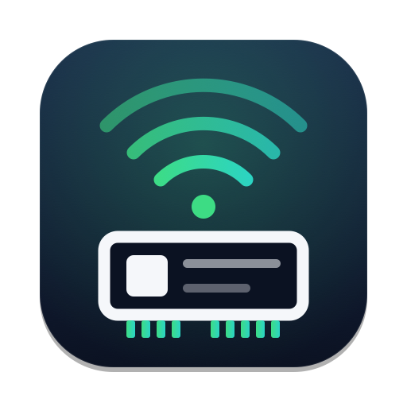

<p align="center">
  
</p>

<h1 align="center">RTL8723BE Wi-Fi</h1>

<p align="center">
  <b>Make the Realtek RTL8723BE Wi-Fi card work on a Hackintosh.</b><br>
  Scan, join WPA2 networks and get online, with an app that lives in your menu bar.
</p>

<p align="center">
  <sub>By <a href="https://issen.kurokamicorp.com/"><b>Issen Software Group</b></a> · hardware support ported from the Linux <a href="https://github.com/torvalds/linux/tree/master/drivers/net/wireless/realtek/rtlwifi/rtl8723be">rtl8723be</a> driver</sub>
</p>

<p align="center">
  <a href="https://www.paypal.com/donate/?business=juanesgtgt2%40gmail.com&no_recurring=0&item_name=Issen+Software+Group">
    
  </a>
</p>

---

## What it does

The Realtek RTL8723BE is the Wi-Fi + Bluetooth card in many HP, Lenovo, Acer and Toshiba
laptops from 2014–2017. macOS has never had a driver for it, so on a Hackintosh the card simply
doesn't exist.

RTL8723BE Wi-Fi fixes that. It adds a driver for the card and an app to scan and join networks,
so your Mac gets online without a USB dongle or a card swap.

- **Scan and join 2.4 GHz networks** secured with WPA2 Personal.
- **One click to connect.** Pick a network, type the password, done.
- **Lives in the menu bar**, with live upload and download speeds.
- **Finds the right antenna by itself.** Many laptops have a single antenna on the "wrong" port;
  the first scan checks both and keeps the one that works.
- **Command-line tool included** for scripts and power users.
- **Installs with one package.** Nothing touches your EFI partition or NVRAM.

Tested on an HP laptop (`103c:804c`) with macOS 26 Tahoe: WPA2 connection, DHCP, about
4 ms to the router and around **3.5 Mbps** of real download speed.

> **RTL8723BE Wi-Fi** is made by [**Issen Software Group**](https://issen.kurokamicorp.com/). The
> hardware setup is a port of the Linux kernel's `rtl8723be` driver, and the card runs Realtek's
> own firmware from [linux-firmware](https://git.kernel.org/pub/scm/linux/kernel/git/firmware/linux-firmware.git)
> (see [NOTICE.md](NOTICE.md)).

---

## Install

1. Make sure your OpenCore setup can load third-party kernel extensions (SIP kext signing
   disabled, as most Hackintosh setups already have).
2. Add **`rtl8723be_experimental=1`** to `boot-args` in your OpenCore `config.plist`
   (NVRAM › `7C436110-AB2A-4BBB-A880-FE41995C9F82` › `boot-args`) and restart.
   The driver won't start without it.
3. Download the latest **.dmg** from the
   [Releases page](https://github.com/AA-EION/RTL8723BE-macOS-WiFi/releases), open it and run
   **Install RTL8723BE WiFi.pkg**.
4. When macOS asks, go to **System Settings › Privacy & Security**, click **Allow** for the
   RTL8723BE driver, and restart.
5. Open **RTL8723BE Wireless Utility** from Applications, click **Scan**, pick your network and
   enter its password.

That's it. From now on the driver starts with your Mac.

> The installer isn't signed by Apple, so macOS may refuse to open it the first time.
> Right-click it and choose **Open**, or go to **System Settings › Privacy & Security** and click
> **Open Anyway**.

> Don't add the kext to OpenCore's `Kernel › Add` list. Install it with the package instead.

### Updating

Download the new .dmg and run the package again. macOS asks you to allow the new driver once and
to restart.

### Uninstalling

Open the .dmg and run in Terminal:

```bash
sudo /Volumes/RTL8723BE\ WiFi*/uninstall.sh
```

Then restart.

---

## Using it

- **Overview** shows whether you're connected, to which network, your IP address and live speeds.
- **Networks** lists what's nearby. Hover a network and click **Join**, or double-click it.
- **Activity** is a log of what happened. Include it when you report a problem.
- **Settings** lets you reload the driver, pick the antenna by hand and open the app at login.

The toolbar button is always the main action: **Scan** when you're not connected, **Disconnect**
when you are. The menu bar icon shows the same status from anywhere.

Prefer Terminal? The package installs `rtl8723be_cli`:

```bash
rtl8723be_cli scan
rtl8723be_cli connect "Network Name" 'password'
rtl8723be_cli status
rtl8723be_cli disconnect
```

---

## Troubleshooting

| Problem | What to do |
|---|---|
| **The app says the driver isn't loaded** | Check the three steps on the app's welcome screen. Most often the boot flag is missing, or the driver is waiting for **Allow** in Privacy & Security plus a restart. |
| **Very few networks, or weak signal** | The antenna is probably on the other port. Go to **Settings › Antenna** and try the other option, or add `rtl8723be_ant_sel=1` (Aux) or `=2` (Main) to `boot-args`. |
| **Can't join a network** | Only WPA2 Personal (WPA2-PSK) on 2.4 GHz is supported. Open, WEP, WPA3, enterprise and 5 GHz networks won't work. Double-check the password. |
| **Connected, but pages don't load** | If you're also on Ethernet, macOS may prefer it. Check the order in **System Settings › Network**. |
| **Anything else** | Run `rtl8723be_cli diag` and copy the **Activity** log, then open an [issue](https://github.com/AA-EION/RTL8723BE-macOS-WiFi/issues). |

---

## Common questions

**Why doesn't my network show up in the macOS Wi-Fi menu?**
The Wi-Fi menu only works with Apple's own wireless driver framework, which third-party drivers
can't use on current macOS. RTL8723BE Wi-Fi shows up as a wired network port (`en…`) instead.
Use the app or its menu bar icon to pick networks.

**Does Bluetooth work?**
No. This project only covers the Wi-Fi side of the card.

**Why is it slower than on Windows or Linux?**
The driver currently talks to your router with 802.11g speeds. 802.11n support is planned.

**Is it safe?**
The driver refuses to start unless you add the boot flag yourself, and the installer never
touches your EFI partition or NVRAM. It's still a kernel extension, so keep a bootable backup.

**Which laptops work?**
Any with an RTL8723BE card (PCI ID `10ec:b723`). Check in **System Information › PCI**, or run
`ioreg -l | grep -i b723`.

---

## How it works (short version)

```
 RTL8723BE card ──PCIe──▶ RTL8723BEWiFi.kext ──▶ Ethernet interface (en…) ──▶ macOS network stack
                          (radio setup, WPA2,      ▲
                           802.11 ⇄ Ethernet)      └── RTL8723BE Wireless Utility.app / rtl8723be_cli
```

The kext brings the card up the same way Linux does (power sequence, Realtek firmware, radio
tables and calibration), scans, joins networks, runs the WPA2 handshake and encrypts traffic
in software. It hands macOS ordinary Ethernet frames, so DHCP, DNS and routing work as usual.
The app and the command-line tool talk to the kext directly.

---

## For developers

You need macOS 14 or later and **Xcode 26**.

```bash
make all                          # kext + command-line tool
make test-hardware test-crypto    # descriptor, eFuse, table and CCMP tests
./scripts/build_dmg.sh            # app, installer package and dist/RTL8723BE_WiFi_Installer.dmg
./gui/Scripts/make-icon.sh        # re-render the app icon from gui/Resources/Icon/AppIcon.svg
```

`rtl8723be_cli diag | reg | rf | dump | iqk` expose the driver's internals; writes need `sudo`.
Driver messages: `/usr/bin/log show --last 10m --predicate 'eventMessage CONTAINS "RTL8723BE"'`.

---

## Support & Donations

RTL8723BE Wi-Fi is free software. If it has been helpful to you, consider supporting its ongoing development:

<p align="center">
  <a href="https://www.paypal.com/donate/?business=juanesgtgt2%40gmail.com&no_recurring=0&item_name=Issen+Software+Group">
    
  </a>
</p>

* **PayPal**: [Donate via PayPal](https://www.paypal.com/donate/?business=juanesgtgt2%40gmail.com&no_recurring=0&item_name=Issen+Software+Group)
* **PayPal Email**: `juanesgtgt2@gmail.com`

---

## License

Copyright © 2026 Issen Software Group. Licensed as openly as its origins allow
(details in [LICENSE](LICENSE); every source file has an `SPDX-License-Identifier`):

- **MIT** ([LICENSES/MIT.txt](LICENSES/MIT.txt)) for everything original: the app, the
  command-line tool, the app↔driver interface, the WPA2 crypto, installer, scripts, tests and docs.
  Parts of the app's interface are adapted from [TetherKitNext](https://github.com/AA-EION/TetherKitNext)
  / [TetherKit](https://github.com/XiaoMiku01/TetherKit) (MIT).
- **GPL-2.0-only** ([LICENSES/GPL-2.0-only.txt](LICENSES/GPL-2.0-only.txt)) for the kernel driver's
  hardware support, which is ported from the Linux kernel's `rtlwifi/rtl8723be` driver
  (© Realtek Corporation), and therefore for the compiled `RTL8723BEWiFi.kext`. This repository
  is its complete source.
- **Realtek firmware licence** ([LICENSES/LicenseRef-rtlwifi-firmware.txt](LICENSES/LicenseRef-rtlwifi-firmware.txt))
  for the embedded `rtl8723befw_36.bin`, redistributed unmodified.

See [NOTICE.md](NOTICE.md) for third-party notices.
